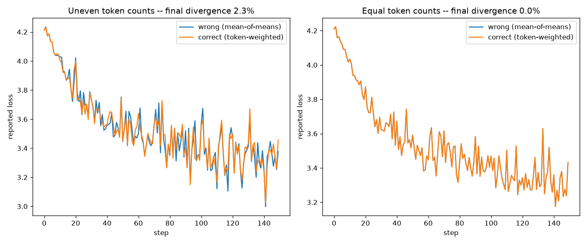
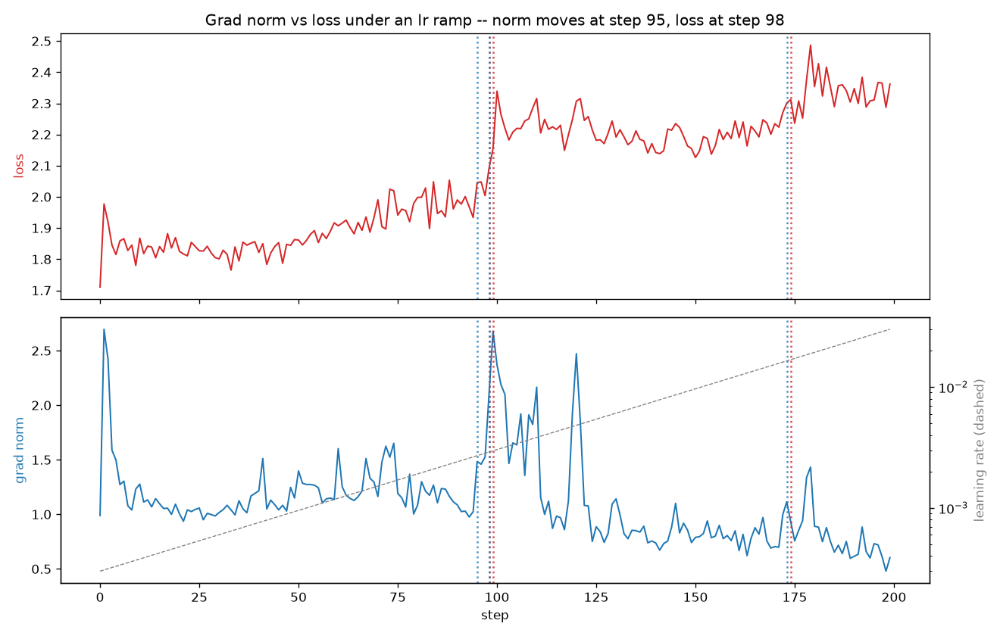

# Session 10 — Assignment

- Model: nanoGPT decoder-only transformer (`transformer.wte`, `transformer.wpe`,
  `transformer.h[i].attn.c_attn/c_proj`, `transformer.h[i].mlp.c_fc/c_proj`, `lm_head`,
  weight-tied) — **4,771,328 params**, 6 layers, 8 heads, n_embd=256, block_size=128.
  Attention is computed manually (`q @ k.T`, softmax, `@ v`), not via a fused kernel, so
  Task 1 can actually see the `(B, nh, T, T)` score tensor.
- Data: Tiny Shakespeare, char-level tokenizer, vocab size 65.
- Hardware: Apple M3 Pro (18-core GPU), no CUDA available in this environment.

**Notebook:** [s10_all_tasks.ipynb](s10_all_tasks.ipynb) runs every task top to bottom with outputs and plots saved inline (each code cell is the matching `0X_*.py` script). All numbers below come from that run and are read back from `results/*.json` in its final summary cell.

## Tensor shapes

| Tensor | Shape (B=8, T=128, C=256, nh=8, hd=32, V=65) | What each dimension is |
|---|---|---|
| input `idx` | `(8, 128)` | B = batch size, T = sequence length (tokens per sequence) |
| targets | `(8, 128)` | same as idx; `targets[b,t]` is the token that should follow `idx[b,t]` |
| token embeddings (`wte(idx)`) | `(8, 128, 256)` | C = model dimension (n_embd) |
| position embeddings (`wpe(pos)`) | `(128, 256)` | one row per absolute position, broadcast over batch |
| c_attn output (qkv combined) | `(8, 128, 768)` | 3×C: one fused linear produces Q, K, V together, then split |
| q / k / v (reshaped to heads) | `(8, 8, 128, 32)` | nh = number of heads, hd = C/nh; C is **split** across heads, not duplicated |
| attention scores (`q @ k.T`) | `(8, 8, 128, 128)` | the two T's are query-position and key-position — the affinity matrix, per head, per sequence |
| attention output (`att @ v`) | `(8, 8, 128, 32)` | same shape as per-head v; each query position now holds a weighted mix of value vectors |
| attention output (heads merged) | `(8, 128, 256)` | heads concatenated back along the last dim to restore C |
| MLP `c_fc` output | `(8, 128, 1024)` | nanoGPT convention: MLP hidden width is 4×n_embd |
| final logits | `(8, 128, 65)` | V = vocab_size; one score per vocab token, per position, per sequence |

## Verify one gradient by hand

| Weight | autograd | numerical (eps=1e-2) | rel. error |
|---|---|---|---|
| `transformer.h[0].mlp.c_fc.weight[3,7]` | 0.000292 | 0.000304 | 3.98% |
| `transformer.h[2].attn.c_attn.weight[10,20]` | 0.000216 | 0.000215 | 0.79% |
| `transformer.h[5].mlp.c_proj.weight[0,0]` | 0.000387 | 0.000381 | 1.40% |
| `lm_head.weight[5,5]` | 0.000566 | 0.000560 | 1.02% |

**Match:** three of four weights agree with autograd to within 1.4% at `eps=1e-2`; `c_fc[3,7]` is at 3.98%, just over the script's 3% pass line. With a gradient of ~3e-4 against a loss of ~1.6, `loss_plus - loss_minus` is only ~6e-6, close to fp32's precision floor at that loss magnitude, so the numerical estimate itself is noisy. Shrinking eps to 1e-4 makes it worse (see notebook), which confirms the error comes from fp32 cancellation, not from autograd.

## Break gradient accumulation on purpose

| | final-step divergence |
|---|---|
| uneven token counts per micro-batch | **2.28%** |
| equal token counts per micro-batch | **0.00%** |

## Grad norm vs loss: the norm moves first

A grad norm that *leads* the loss is a symptom of the weights going unstable, so the run
creates that condition: start from the checkpoint and ramp
the learning rate exponentially 3e-4 → 3e-2 over 200 steps, no clipping, logging every step.

Each step is z-scored against the trailing 20 steps (the loss drifts upward as lr rises, so
a fixed baseline would flag drift, not a spike). Window: steps 75–94.

| step | lr | loss | loss z | grad norm | grad norm z |
|---|---|---|---|---|---|
| 94 | 2.64e-03 | 1.934 | −1.0 | 1.024 | −1.1 |
| **95** | 2.70e-03 | 2.046 | 1.8 | 1.483 | **3.3** ← norm moves |
| 96 | 2.77e-03 | 2.048 | 1.9 | 1.459 | 3.0 |
| 97 | 2.83e-03 | 2.004 | 0.8 | 1.525 | 3.7 |
| **98** | 2.90e-03 | 2.092 | **3.0** ← loss moves | 2.106 | 9.2 |
| 99 | 2.97e-03 | 2.155 | 4.6 | 2.679 | 14.7 |

**The grad norm moved at step 95; the loss followed at step 98 — a 3-step lead.** At step 97
the loss even dips back to z=0.8 while the norm keeps climbing, which is exactly why watching
the loss alone would miss it.

Why the norm leads: once lr passes the stability edge of the sharpest direction in the loss
surface, each update overshoots along that direction and the overshoot grows. The gradient
along it is *linear* in the overshoot, but the loss is *quadratic* in it, so for small
overshoots the norm change is first-order and visible while the loss change is second-order
and hidden in per-batch noise (σ ≈ 0.04 here).

Note: MPS is not bit-deterministic. Steps 0–99 reproduce to 4 decimals across runs, so the
step 95 → 98 event is stable, but later borderline events (past step 150) appear in
some runs and not others.

## MFU

| | value |
|---|---|
| params (N) | 4,771,328 |
| batch size × block size | 32 × 128 = 4,096 tokens/step |
| tokens/sec (steady state, 50 steps) | ~52,600 |
| achieved FLOPs (6·N·tokens/sec) | 1.51e12 |
| peak FLOPs (M3 Pro, 18-core, fp32) | 7.38e12 |
| **MFU** | **~20.4%** |

##  Representing 0.1 in fp32, bf16, fp8 E4M3

| Format | Sign | Exp bits | Mantissa bits | Stored value | Abs. error vs 0.1 |
|---|---|---|---|---|---|
| fp32 | 0 | 8 | 23 | 0.10000000 | 1.49e-09 |
| bf16 | 0 | 8 | 7 | 0.10009766 | 9.77e-05 |
| fp8 e4m3 | 0 | 4 | 3 | 0.10156250 | 1.56e-03 |

**Format choice:** bf16 for training. Its 8 exponent bits give it fp32's dynamic range
(no overflow/underflow the way fp16's narrow exponent causes), at half the memory —
the right range-for-precision trade for activations and gradients, as long as loss
accumulation and optimizer moments stay in fp32 (bf16's error here, 9.77e-05, is ~65,000×
fp32's). fp8 E4M3's error (1.56e-03, ~1,000,000× fp32's) is too coarse for anything that
accumulates error over many steps — attention/softmax internals or optimizer state — and
belongs only where current practice actually uses it: as matmul *input* precision, where a
higher-precision accumulator absorbs the rounding error before it can compound.
